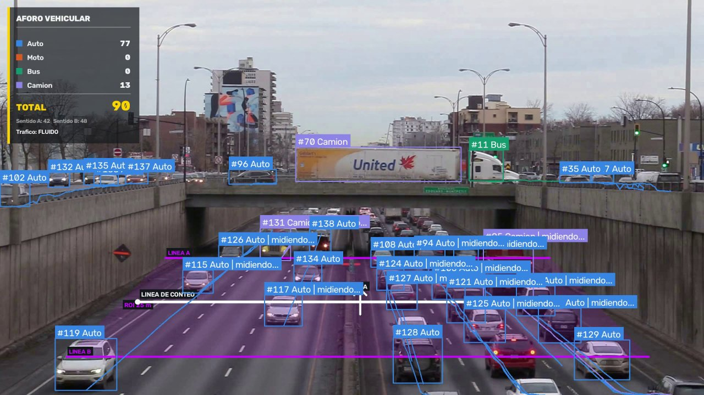
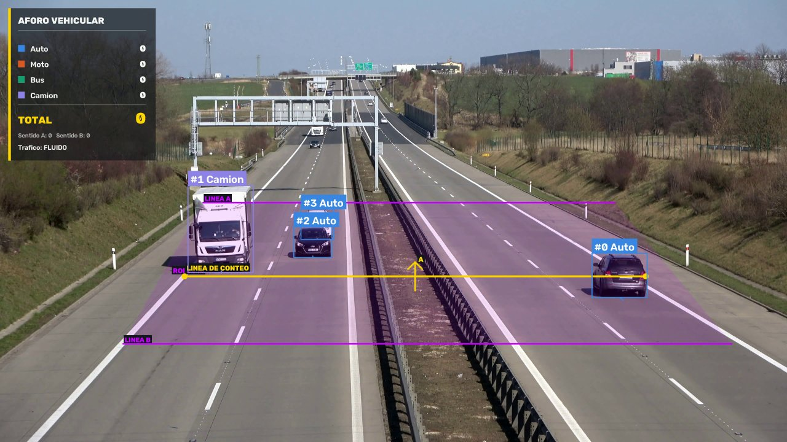
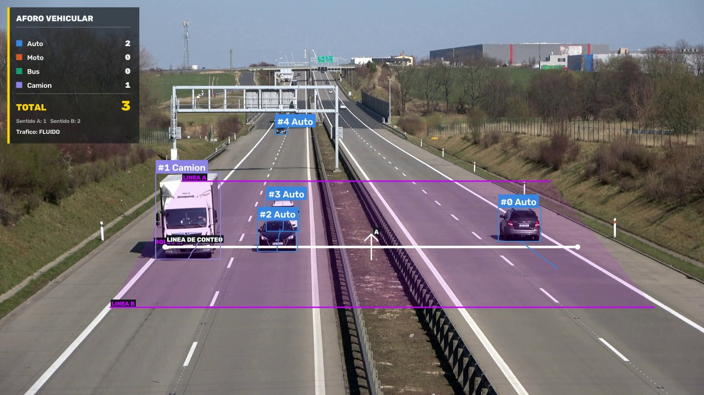
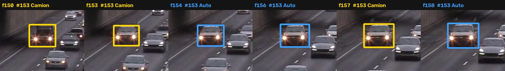
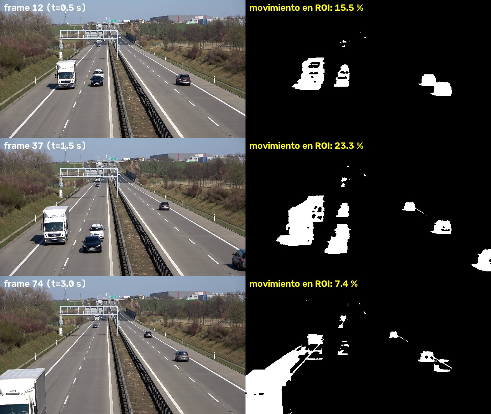

# Casos de falla

Cinco casos **observados en ejecuciones reales** del sistema (no hipotéticos), cada uno con
evidencia, causa, impacto en el cliente y mitigación. Las imágenes están en
[`fallas/`](fallas/): las de los casos 1 y 2 son frames de los videos anotados por `main.py`
(extraídos con `capturar_fallas.py`) y las de los casos 3 y 4 se regeneran con
`python generar_evidencia_fallas.py`. Los videos son los públicos de `descargar_videos.py`.

| # | Caso | Video | Gravedad para el cliente |
|---|---|---|---|
| 1 | Tráfico denso: IDs fragmentados y conteo inflado | `autopista_2` | Alta (el aforo deja de ser fiable) |
| 2 | Vehículos que ya están en la ROI al empezar: velocidad `NULL` | `autopista_1` | Baja (solo al inicio del video) |
| 3 | El mismo vehículo cambia de clase (auto ↔ camión) | `autopista_2` | Media (error de aforo **por tipo**) |
| 4 | La máscara de movimiento se infla con sombras y estelas | `autopista_1` | Media (lecturas de movimiento sobreestimadas) |
| 5 | Distancia de calibración incorrecta: velocidades y alertas falsas | `autopista_2` | Alta (alertas falsas) |

---

## Caso 1 — Tráfico denso: IDs fragmentados y conteo inflado

**Qué pasa.** En una autopista con ~40 vehículos visibles a la vez, ByteTrack no logra mantener
un ID por vehículo: los vehículos "reaparecen" con un ID nuevo en mitad de la escena y cada ID
nuevo que cruza la línea se cuenta otra vez.

**Evidencia (medida).**
- `verificar_tracking.py` sobre `autopista_2` (300 frames): **311 IDs**, vida mediana de un ID
  **23 frames (0.8 s)**, y **211 de los 311 IDs nacen en el 40 % inferior de la imagen**, donde los
  vehículos ya son grandes y no deberían "aparecer" de la nada. En el video fluido `autopista_1`:
  8 IDs en 250 frames, 6 de ellos de más de 60 frames.
- Con las líneas de prueba, el sistema registró **322 cruces en 450 frames (15 s)**. Un corredor de
  ~10 carriles con flujo de saturación (~2 000 veh/h/carril) deja pasar como máximo ≈ 90 vehículos
  en 15 s: el conteo está inflado al menos ~3.5 veces. (No hay verdad de terreno anotada de este
  video; la cota física basta para afirmar que el conteo es imposible.)
- Solo el 77.7 % de las detecciones tiene una pareja (IoU > 0.5) en el frame anterior: la
  detección "parpadea" y el tracker pierde y recrea tracks.

**Causa.** Oclusión mutua constante, cajas pequeñas y lejanas, y parpadeo de las detecciones de
YOLO. **No** es un problema de resolución (con `imgsz=1280` hubo 177 IDs contra 158 con 960 en los
mismos 150 frames) ni de parámetros: se probaron 9 variantes de ByteTrack (buffer, umbrales de
activación, IoU, frames de confirmación) y ninguna lo resuelve.

**Mitigación propuesta.** Re-identificación por apariencia (BoT-SORT/ReID), exigir una vida mínima
(≥ N frames) antes de contar un ID, contar por carril con una cota de flujo físico como
verificación, y un ángulo de cámara con menos solapamiento. En tráfico fluido (`autopista_1`,
`carretera_3`) el problema no aparece.

---

## Caso 2 — Vehículos que ya están en la ROI al empezar: velocidad `NULL`

**Qué pasa.** La velocidad exige ver al vehículo cruzar las dos líneas A y B. Los vehículos que ya
están dentro de la ROI cuando empieza el video nunca cruzan la línea de entrada y quedan sin
velocidad.

**Evidencia (medida).** En `autopista_1`, 4 de las 10 filas de `cruces` tienen
`velocidad_kmh = NULL`: son exactamente los que cruzan la línea de conteo en el primer segundo
(`momento` 08:00:00.24 a 08:00:00.88), los que se ven dentro de la ROI en las imágenes de arriba.
Los 6 vehículos restantes sí tienen velocidad.

**Causa.** Diseño de la medición por tiempo de tránsito entre dos líneas.

**Impacto.** Solo afecta a los vehículos presentes al arrancar la grabación; en una cámara en
operación continua ocurre una vez. El conteo (aforo) no se ve afectado.

**Mitigación.** Empezar la grabación con la ROI libre, o descartar del análisis de velocidad el
primer segundo; se guarda `NULL` (y no 0) para que nunca se confunda con una velocidad real.

---

## Caso 3 — El mismo vehículo cambia de clase (auto ↔ camión)

**Qué pasa.** Una camioneta (*pickup*) con ID 153 se etiqueta alternadamente **Camión** y **Auto**
en frames consecutivos (frames 150–153 Camión → 154–156 Auto → 157 Camión → 158 Auto), aun con
la votación mayoritaria que `tracker.py` aplica a la clase.

**Evidencia (medida).** En `autopista_2`, la clase estabilizada de un ID cambia 47 veces en 300
frames (61 en 400 frames); en `autopista_1`, 6 veces en 538 frames; en `carretera_3`, ninguna.

**Causa.** Vehículos ambiguos entre las clases de COCO (pickup, SUV grande, furgoneta): YOLO da
puntajes casi iguales a `car` y `truck`, y cuando los votos acumulados empatan, la clase "ganadora"
oscila.

**Impacto.** El total de vehículos no cambia, pero el **aforo por tipo** puede quedar mal
repartido (un auto contado como camión), porque el tipo se guarda en el instante del cruce.

**Mitigación.** Decidir la clase al final de la vida del track (no al cruzar), votar ponderando por
confianza, añadir histéresis (cambiar de clase solo si la nueva supera por un margen), o ajustar el
modelo con datos propios etiquetados (*fine-tuning*).

---

## Caso 4 — La máscara de movimiento se infla con sombras y estelas

**Qué pasa.** En el análisis de movimiento (resta de fondo + umbral + morfología) la región blanca
de la máscara es mayor que el vehículo: incluye su **sombra** (izquierda del camión) y una
**estela** donde el fondo aún "recuerda" la posición anterior (el fondo es un promedio móvil, no
un frame limpio).

**Evidencia (observada).** En el frame 37 (t = 1.5 s) de `autopista_1`, la máscara del camión blanco
es claramente mayor que el vehículo (abarca su sombra y su rastro) y el indicador marca 23.3 % de la
ROI en movimiento con solo cuatro vehículos en la escena.

**Impacto.** `ratio_roi` (columna `ratio_movimiento` de `lecturas_trafico`) sobreestima el área en
movimiento. La alerta de **tráfico detenido** no usa ese valor sino `ratio_en_vehiculos` (restringido
a las cajas de YOLO), que es menos sensible a sombras, pero las lecturas guardadas sí quedan
infladas.

**Limitaciones relacionadas.** (a) La detección de tráfico detenido se evalúa para **toda la ROI**,
no por carril: un carril detenido con los demás en movimiento no se detecta. (b) Ningún video
público disponible muestra una detención real, por lo que esa alerta está verificada con pruebas
unitarias (`tests/test_movimiento.py`) y deberá validarse con un video propio (p. ej. en un
semáforo).

**Mitigación.** Quitar sombras (umbral en canales HSV/luminancia), calcular el ratio solo dentro
de las cajas, o usar sustracción de fondo adaptativa (MOG2) con detección de sombras.

---

## Caso 5 — Distancia de calibración incorrecta: velocidades y alertas falsas

**Qué pasa.** La velocidad es `v = distancia / tiempo`; un error relativo en la distancia produce el
mismo error relativo en la velocidad. En la prueba de `autopista_2` se usó una distancia de 25 m
**supuesta, sin medir**, para las líneas A–B.

**Evidencia (medida).** Con esa distancia el sistema midió 67 velocidades con **promedio de 140
km/h**, muchas pegadas al tope de plausibilidad (200 km/h), y generó **59 alertas de exceso de
velocidad** sobre un límite de 60 km/h, en un corredor urbano congestionado donde esos valores no
son creíbles. Con una distancia razonable en `autopista_1` (50 m supuestos) los valores sí
quedaron en 38–67 km/h, lo que muestra que el resultado depende por completo de esa medida.

**Causa.** Entrada de calibración errónea (error humano), no un fallo del algoritmo: el sistema no
puede saber que la distancia es incorrecta.

**Impacto.** Alertas falsas masivas: el cliente perdería confianza en el sistema.

**Mitigación.** Medir la distancia en el sitio con cinta (ver [`DATOS.md`](DATOS.md)), validar con
pasadas a velocidad de referencia (`evaluar.py` reporta MAE y recall/precisión del exceso),
ajustar `VELOCIDAD_MAX_KMH` a lo plausible para la vía y desconfiar de lotes de mediciones
pegadas al tope.

---

## Casos no verificados todavía

No se probó con **baja luz, lluvia o niebla**; se espera menor confianza de YOLO y un fondo más
ruidoso. Se documentarán cuando el equipo grabe esos escenarios (ver [`DATOS.md`](DATOS.md)).
