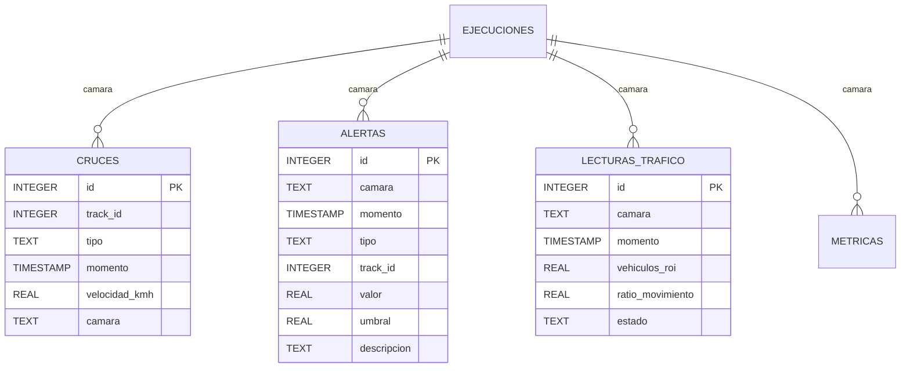
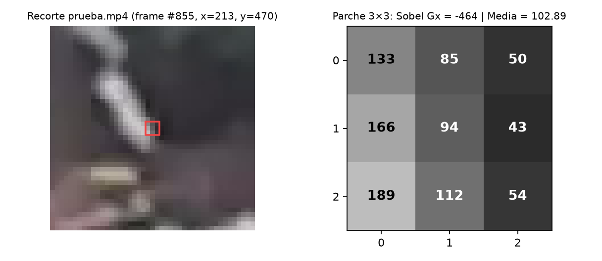
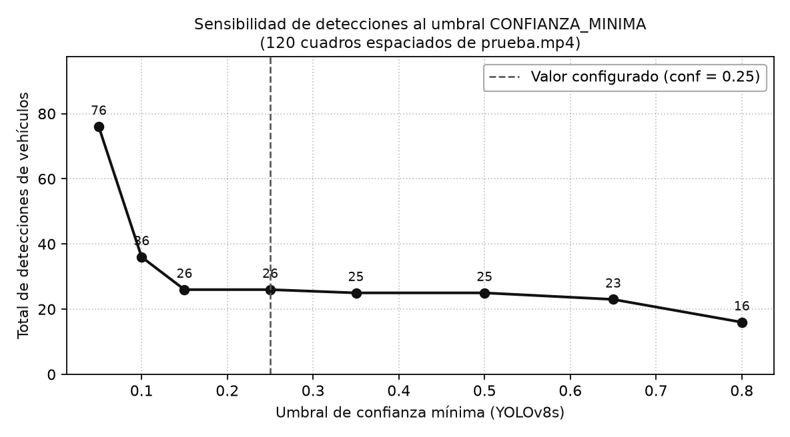

# Informe Final: Sistema de Aforo Vehicular y Estimación de Velocidad con YOLOv8

| Campo | Información |
|---|---|
| **Institución / Programa** | Universidad de La Guajira — Ingeniería de Sistemas |
| **Asignatura** | Internet de las Cosas (IoT) |
| **Docente** | Eduardo Sierra Fragozo (`elsierra@uniguajira.edu.co`) |
| **Proyecto** | #1 — Aforo vehicular con estimación de velocidad |
| **Integrantes** | Nelson Cotes y Nolger Rodriguez |
| **Repositorio en GitHub** | <https://github.com/TheWiche/aforo-vehicular-yolo> |
| **Video demo** | <https://drive.google.com/file/d/1CEaKPCf7svNbZtTBXNghjAELMgU_hO8I/view?usp=sharing> |
| **Video propio (`prueba.mp4`)** | <https://drive.google.com/file/d/1uIu75rfCu8QMMPlDfBzAZOLBPvNdPInT/view?usp=sharing> |

---

## 1. Contexto empresarial

### a. Ficha del cliente
- **Entidad:** **Secretaría de Tránsito y Movilidad Distrital de Riohacha** *(caso de estudio aplicado a la región)*.
- **Sector:** Sector público — Gestión de movilidad urbana y seguridad vial.
- **Actividad:** Regulación del tránsito, estudios de flujo vehicular, control de velocidades en corredores urbanos y prevención de siniestros en el distrito de Riohacha, La Guajira.
- **Usuarios del sistema:** (1) **Ingeniero(a) / Analista de Movilidad**, quien consulta volúmenes por tipo vehicular, velocidad media y percentil $V_{85}$ para diseñar señalización o reductores; (2) **Operador del Centro de Gestión Vial**, quien calibra cámaras, ejecuta el análisis de grabaciones y revisa alertas.

### b. Problema de negocio
Actualmente los estudios de tráfico se realizan mediante **aforos manuales esporádicos** (personal en vía con planillas y contadores durante 2 a 4 horas). No contar con el sistema le cuesta a la Secretaría:
- **Tiempo:** ~**12 horas hombre** por cada estudio puntual (~8 h de conteo en vía + ~4 h de digitación en hojas de cálculo), retrasando varios días los informes.
- **Dinero:** Gasto operativo de **COP \$1.200.000 a \$1.800.000 por punto monitoreado al mes** en viáticos, turnos y consolidación, sin construir histórico consultable.
- **Riesgo:** **0 % de cobertura en medición de velocidad** (se desconoce qué conductores superan 30–50 km/h en vías urbanas) y detección tardía de congestiones o incidentes, elevando el riesgo de siniestros viales (especialmente de motociclistas).

### c. Indicadores de éxito
- **Operativo:** Reducir el tiempo entre grabación e informe de **~12 horas manuales a < 15 minutos** (**ahorro > 95 %**).
- **Técnicos (verificables con `python -m aforo evaluar`):** Error de aforo $\le 10\,\%$, $F_1$ de cruces $\ge 0.90$, acierto de clasificación $\ge 85\,\%$, MAE de velocidad $\le 5\text{ km/h}$ y recall de excesos $\ge 80\,\%$.

### d. Requisitos del cliente
- **Funcionalidad:** Detectar y clasificar `Auto`, `Moto`, `Bus` y `Camion` en video de cámara fija; contar cada vehículo una sola vez al cruzar una línea virtual; estimar velocidad media en un tramo calibrado en metros; alertar `EXCESO_VELOCIDAD` y `TRAFICO_DETENIDO`; almacenar todo en una base de datos relacional (`SQLite`) y mostrarlo en un **dashboard web**.
- **Instalación y operación:** Corre **100 % local** (fuera de Google Colab) en un PC de la sede de la Secretaría con Windows/Linux (`python iniciar.py`). Lo opera un técnico de movilidad desde el navegador (`http://localhost:8501`) arrastrando las líneas de calibración sobre el video, sin editar código.

*(Detalle ampliado en [`CONTEXTO_CLIENTE.md`](CONTEXTO_CLIENTE.md).)*

---

## 2. Datos (propios y públicos)

| Fuente | Tipo | Características | Uso |
|---|---|---|---|
| `datos/videos/prueba.mp4` | **Propio (principal)** | 1920×1080, 30 FPS, 31,793 frames (~17 min 39 s), vía urbana local | Calibración (`DISTANCIA_REAL_METROS = 3.5` m, límite 30 km/h), ejecución principal (`prueba`) y análisis técnico |
| `datos/videos/Prueba1_optimizado.mp4` | **Propio (exploratorio)** | 1920×1080, 30 FPS, 32,102 frames, vía lateral | Prueba previa (`prueba1`, `4.7 m`, comparación tiempo real CPU vs GPU) |
| `autopista_1.mp4` | Público (Roboflow `supervision`, MIT) | 3840×2160, 25 FPS, 538 frames | Pruebas funcionales y casos de falla (velocidad `NULL`, sombras) |
| `autopista_2.mp4` | Público (Roboflow `supervision`, MIT) | 1920×1080, tráfico muy denso | Prueba de estrés y caso de falla de fragmentación de IDs |
| `carretera_3.mp4` | Público (Pexels #854671) | 1920×1080, 25 FPS, 1,501 frames | Prueba de regresión en tráfico moderado |

**Separación entrenamiento vs. evaluación:** No se realizó *fine-tuning* sobre los videos del proyecto; YOLOv8 (`yolov8s.pt` / `yolov8n.pt`) utiliza pesos preentrenados en **COCO** (Lin et al., 2014). Todos los videos son **datos no vistos en el entrenamiento** (detalle y citas en [`DATOS.md`](DATOS.md)).

---

## 3. Metodología y técnicas del curso

```
video ─► YOLOv8 (detector.py) ─► ByteTrack (tracker.py) ─► cruce de línea (line_counter.py) ─► INSERT cruces
            │                                            └► tiempo A→B (speed_estimator.py) ──► alerta exceso
            └► resta de fondo |I−B| ─► umbral ─► apertura/cierre (movimiento.py) ─► ¿detenido? ─► alerta vía
                                                                                                      │
                                                       SQLite (datos/db/database.db) ◄────────────────┘
                                                                  │
                                                                  ▼
                                                   Dashboard web propio (FastAPI + HTML/CSS/JS)
```

El sistema combina **cuatro técnicas vistas en el curso** (detalle en [`TECNICAS.md`](TECNICAS.md)):
1. **Redes neuronales convolucionales / YOLO (`detector.py`):** `yolov8s.pt` (`conf=0.25`, `iou=0.5`, `imgsz=960`) filtra las clases COCO `2: Auto`, `3: Moto`, `5: Bus`, `7: Camion`.
2. **Operaciones aritméticas sobre imágenes (`movimiento.py`):** resta absoluta `D = |I - B|` (`cv2.absdiff`) contra un modelo de fondo actualizado por promedio móvil exponencial `B ← (1 - α)·B + α·I` (`cv2.accumulateWeighted`, `α = 0.02`).
3. **Umbralización y morfología matemática (`movimiento.py`):** binarización `cv2.threshold(D, 25, 255, THRESH_BINARY)`, seguida de **apertura** (elemento elíptico 3×3) para eliminar ruido aislado y **cierre** (7×7) para rellenar huecos dentro de cada vehículo.
4. **Geometría computacional y relación píxel–metro (`geometry.py`, `speed_estimator.py`):** intersección de segmentos mediante producto cruz 2D con interpolación sub-frame $t \in [0, 1]$ y velocidad media $v = (\text{distancia\_m} / \text{tiempo\_s}) \times 3.6$.

---

## 4. Modelo de base de datos

El almacenamiento final es **SQLite 3** (`datos/db/database.db`) en modo **WAL** para lectura concurrente del dashboard (`PRAGMA query_only`) mientras el pipeline inserta cada evento con `commit()` inmediato y consultas parametrizadas (`?`). No se usa CSV como almacenamiento final.



Además existen las tablas `ejecuciones`, `metricas` y la vista SQL `v_aforo_por_minuto` (DDL completo en [`MODELO_DATOS.md`](MODELO_DATOS.md) y script SQL en [`schema.sql`](schema.sql)).

---

## 5. Resultados, métricas y casos de falla

### Resultados registrados en SQLite (`datos/db/database.db`)
| Cámara / Video | Cruces totales | Con velocidad | Vel. promedio (km/h) | Desglose por tipo | Alertas `EXCESO_VELOCIDAD` |
|---|---|---|---|---|---|
| `prueba` (`prueba.mp4`, 17.6 min) | **177** | 171 (96.6 %) | **25.4** | Moto: 132 (27.2 km/h), Auto: 40 (19.6 km/h), Camión: 5 (21.3 km/h) | **45** (30.1 – 41.1 km/h; límite 30) |
| `prueba1` (`Prueba1_optimizado.mp4`, 17.8 min) | **179** | 171 | **29.2** | Moto: 136 (31.6 km/h), Auto: 42 (21.8 km/h), Camión: 1 (16.6 km/h) | **83** (30.1 – 47.5 km/h; límite 30) |
| `autopista_1` (538 fr.) | **10** | 6 | **52.5** | Auto: 8 (55.2 km/h), Camión: 2 (39.0 km/h) | **1** (68.1 km/h; límite 60) |
| `carretera_3` (1,501 fr.) | **30** | 25 | **18.0** | Auto: 28, Moto: 1, Camión: 1 | **0** (límite 50) |

En `prueba`, el estado de la vía registrado en `lecturas_trafico` fue mayoritariamente `LIBRE` (199 lecturas) y `FLUIDO` (12 lecturas), sin episodios de tráfico detenido.

### Auditoría de tracking y comparación de modelos
1. **Auditoría de invariantes (`python -m aforo auditar`):** verificó **0 IDs repetidos** y **0 IDs reutilizados** en todos los videos evaluados:
   - `prueba.mp4` (3,000 frames): **7 IDs**, vida media **47.3 frames**, **0** IDs efímeros (< 8 fr.), **0** saltos sospechosos y **0** cambios de clase (`IDs ÚNICOS Y CONSISTENTES`).
   - Videos públicos: `autopista_1` (538 fr., 12 IDs, 0 efímeros), `carretera_3` (300 fr., 12 IDs, 0 efímeros) y `autopista_2` (400 fr., 410 IDs por congestión densa).
2. **Comparación de arquitecturas (`yolov8n.pt` vs. `yolov8s.pt` en `carretera_3.mp4`, 1,501 frames @ 960 px en GPU RTX 2070 SUPER):**

| Modelo | Tiempo (s) | Velocidad (FPS) | Cruces totales | Desglose por tipo | Velocidad media (rango) |
|---|---|---|---|---|---|
| `yolov8n.pt` (Nano) | 42.4 s | **35.40 FPS** | 31 | Auto: 28, Moto: 1, Camión: 2 | **18.0 km/h** (13.7 – 22.1) |
| `yolov8s.pt` (Small) | 51.4 s | 29.24 FPS | 30 | Auto: 28, Moto: 1, Camión: 1 | **18.0 km/h** (13.7 – 22.2) |

`yolov8n` resulta ~21 % más veloz manteniendo idéntica velocidad media (18.0 km/h), mientras que `yolov8s` conserva mayor estabilidad en la clasificación entre vehículos livianos y pesados. La suite de evaluación contra verdad de terreno (`anotar` + `evaluar`) queda implementada y verificada mediante pruebas unitarias en `tests/test_evaluar.py` (155 pruebas totales en `OK`).

### Casos de falla documentados (5 observados con evidencia en `docs/fallas/`)
1. **Tráfico denso (`autopista_2`):** ByteTrack fragmenta trayectorias (311 IDs en 300 frames, vida mediana 23 frames) e infla el conteo ~3.5×.
2. **Inicio dentro de la ROI (`autopista_1`):** 4 de 10 vehículos ya estaban dentro de A–B en el frame 1 y registran `velocidad_kmh = NULL` (preferible a un falso 0).
3. **Oscilación de clase (`autopista_2`, ID 153):** una camioneta alterna entre `Auto` y `Camion`, afectando el aforo por tipo.
4. **Sombras y estelas en la máscara (`autopista_1`, frame 37):** inflan `ratio_movimiento` (23.3 % de la ROI), mitigado en alertas usando `ratio_en_vehiculos`.
5. **Calibración errónea de distancia (`autopista_2`):** una distancia supuesta incorrecta (25 m) produce promedio irreal de 140 km/h y 59 alertas falsas.

---

## 6. Análisis técnico y fundamento del sistema

### A. ¿Por qué funciona el modelo?
1. **Flujo paso a paso de un cuadro:** (1) OpenCV decodifica el frame BGR $(H \times W \times 3)$; (2) Ultralytics realiza *letterbox* a $960 \times 960$, convierte BGR→RGB y normaliza $[0,255] \to [0,1]$; (3) la CNN de YOLOv8 predice cajas $(x,y,w,h)$, confianza y probabilidades de 80 clases, filtradas por `conf >= 0.25`, NMS (`iou=0.5`) y clases $\{2,3,5,7\}$; (4) ByteTrack asocia detecciones con filtro de Kalman + IoU en dos rondas (alta y baja confianza) y estabiliza la clase por votación mayoritaria; (5) `LineCounter` evalúa el corte de segmentos por producto cruz para contar e insertar en SQLite; (6) `SpeedEstimator` mide $\Delta t = \Delta\text{frames} / \text{FPS}$ entre las líneas A y B; (7) en paralelo, `DetectorMovimiento` reduce el frame, lo pasa a gris, resta el fondo móvil y aplica umbral + morfología para vigilar congestiones.
2. **Qué aprende la red (primeras capas vs. últimas capas):** Durante el entrenamiento por retropropagación se ajustan los pesos de los filtros convolucionales. Las **primeras capas** (cercanas a la entrada) aprenden detectores locales de bajo nivel: bordes horizontales/verticales, esquinas y gradientes de color o textura. Las **capas intermedias** combinan esos bordes en partes (llantas, faros, parabrisas, manubrios). Las **últimas capas** (cabezal de detección multi-escala P3/P4/P5) integran contexto semántico completo para localizar el objeto entero y diferenciar un auto de un bus o una moto.
3. **Por qué sirve el preentrenamiento en COCO:** COCO contiene cientos de miles de ejemplos etiquetados de vehículos bajo múltiples ángulos, escalas e iluminaciones. Las representaciones visuales de bordes, ruedas y carrocerías aprendidas allí se transfieren directamente (*transfer learning* sin reentrenar) a las vías de Riohacha porque la geometría y textura general de autos, motos, buses y camiones es invariante entre regiones.

### B. Lo aprendido en el semestre, funcionando
1. **Tabla de conceptos del curso en el sistema:**

| Concepto del curso | Módulo / Archivo | Papel que cumple |
|---|---|---|
| **Convolución y CNN (YOLO)** | `src/aforo/vision/detector.py` | Extrae mapas de características jerárquicos y predice cajas y clases vehiculares |
| **Operaciones aritméticas entre imágenes** | `src/aforo/vision/movimiento.py` | Resta absoluta `\|I - B\|` y suma ponderada `(1-α)B + αI` para modelar el fondo |
| **Umbralización binaria** | `src/aforo/vision/movimiento.py` | Separa píxeles con cambio real (`D > 25 → 255`) del ruido del sensor |
| **Morfología matemática** | `src/aforo/vision/movimiento.py` | Apertura 3×3 (elimina ruido puntual) y cierre 7×7 (rellena huecos en vehículos) |
| **Modelo geométrico de cámara (relación píxel–metro)** | `src/aforo/analitica/speed_estimator.py` | Mapea la distancia real medida en metros sobre el plano de la vía al cruce de dos líneas en píxeles |
| **Espacios de color y mezcla lineal** | `movimiento.py` / `visualizer.py` | Conversión BGR→Gris para reducir costo de movimiento y `cv2.addWeighted` para el HUD |

2. **Concepto interno no programado manualmente:** Las **capas convolucionales de YOLOv8** ejecutan exactamente la misma operación matemática de filtrado espacial $3\times 3$ vista en clase (`convolución 2D` como producto punto entre kernel y vecindario de píxeles), con la diferencia de que los 9 valores de cada kernel no se definen a mano (como Sobel o Gauss) sino que se aprenden automáticamente mediante descenso de gradiente. Además, el cuello **PANet/FPN** realiza interpolaciones y sumas tensoriales entre escalas.
3. **Efecto de parámetros físicos de cámara (distancia focal, perspectiva, iluminación y distorsión):**
   - **Perspectiva:** en toma oblicua, 1 metro cerca de la cámara ocupa muchos más píxeles que 1 metro lejos. Como se calibró en `Prueba1_optimizado.mp4` (`calibraciones.json`, ~148 px/m en la zona medida), el error geométrico por perspectiva se estima en $\pm 15\,\%$ si un vehículo cambia de carril lateralmente; el cruce entre dos líneas transversales atenúa este efecto frente a medir píxeles frame a frame.
   - **Distancia focal y resolución:** una focal más larga o `imgsz=960` permite detectar motos y autos pequeños a mayor distancia, pero reduce el campo de visión (tramo A–B más corto, menos frames disponibles para medir velocidad).
   - **Iluminación:** sombras fuertes crean falsos cambios en `|I - B|` (Caso de falla 4) y el contraluz reduce la confianza de YOLO.
   - **Distorsión del lente:** el gran angular curva las líneas rectas en los bordes de la imagen; por eso `LINEA_CONTEO`, A y B se ubican en la zona central de la calzada.

### C. Las operaciones aritméticas detrás
1. **Operaciones ejecutadas en cada cuadro:**
   - **Normalización escalar:** `I_norm = I_rgb / 255.0` al entrar a YOLOv8.
   - **Conversión a gris (combinación lineal de canales):** $Y = 0.299R + 0.587G + 0.114B$.
   - **Resta absoluta de imágenes:** `D(x,y) = |I(x,y) - B(x,y)|`.
   - **Promedio móvil ponderado:** `B_t = 0.98·B_{t-1} + 0.02·I_t`.
   - **Umbralización:** `M(x,y) = 255` si `D(x,y) > 25`, si no `0`.
   - **Convoluciones (productos punto + suma) en la CNN** y **operaciones de mínimo/máximo local** en erosión y dilatación morfológica.
2. **Parche real 3×3 a mano vs. OpenCV:**  
   Del frame **#855** de `prueba.mp4`, centrado sobre un vehículo `(x=213, y=470)` en escala de grises, se extrajo el siguiente parche $P$:

$$
P = \begin{bmatrix} 133 & 85 & 50 \\ 166 & 94 & 43 \\ 189 & 112 & 54 \end{bmatrix}
$$

   - **Filtro Sobel horizontal $G_x = \begin{bmatrix}-1 & 0 & 1 \\ -2 & 0 & 2 \\ -1 & 0 & 1\end{bmatrix}$ a mano:**  
     $(-1)(133) + (0)(85) + (1)(50) + (-2)(166) + (0)(94) + (2)(43) + (-1)(189) + (0)(112) + (1)(54) = -83 - 246 - 135 = \mathbf{-464}$.  
     Resultado medido con `cv2.filter2D(gris, cv2.CV_32F, kernel)[470, 213]` = **`-464.0`** (coincidencia exacta).
   - **Filtro promedio 3×3 $\frac{1}{9}\mathbf{1}_{3\times 3}$ a mano:**  
     $(133 + 85 + 50 + 166 + 94 + 43 + 189 + 112 + 54) / 9 = 926 / 9 = \mathbf{102.8889}$.  
     Resultado medido con `cv2.blur(gris, (3, 3))[470, 213]` = **`102.8889`** (coincidencia exacta).

   

3. **Experimento: ¿qué pasa si se quita la normalización de entrada?**  
   Al evaluar directamente el tensor del frame #855 de `prueba.mp4` sin dividir entre `255.0` (rango `[0, 255]` en lugar de `[0, 1]`):
   - **Entrada normalizada `[0, 1]`:** confianza máxima vehicular = `0.8901`, **10** celdas candidatas $\ge 0.25$ (**26** en todas las clases).
   - **Entrada SIN normalizar `[0, 255]`:** los pesos convolucionales y estadísticas de *BatchNorm* quedan multiplicados por ~255×, saturando las activaciones sigmoidales (`max_conf = 1.0000`) y disparando **2,531** celdas vehiculares $\ge 0.25$ (**4,696** en las 80 clases): la red colapsa en una explosión de falsos positivos.

### D. Ajustes y mejoras
1. **Ajustes realizados (antes vs. después con números medidos):**
   - **Hardware y capacidad de modelo sobre 145 s de video propio en `--tiempo-real` (`README.md`):**
     - *Antes (CPU, `yolov8n`, `imgsz=640`):* procesa 1 de cada ~5 frames (~8 FPS en 4K), detectó **7 de 14 vehículos (50 %)** y midió **2 de 13 velocidades**.
     - *Después (GPU RTX 2070 SUPER, `yolov8s`, `imgsz=960`):* procesa 3 de cada 4 frames (~20 FPS), detectó **14 de 14 vehículos (100 %)** y **14 de 14 velocidades** dentro de $\pm 0.5\text{ km/h}$ respecto al modo completo.
   - **Corrección de calibración (`autopista_2` vs. `prueba`):** pasar de una distancia supuesta sin medir (25 m → promedio irreal de 140 km/h y 59 alertas falsas) a una distancia medida en el sitio (`3.5 m` en `prueba.mp4` → velocidad promedio realista de **25.4 km/h** y **96.6 %** de cruces con velocidad medida).
2. **Qué mejoras se proponen:**
   - **Perspectiva:** implementar **homografía** (`cv2.getPerspectiveTransform` / `cv2.warpPerspective`, reto extra del proyecto) para proyectar el tramo a vista cenital (*bird's-eye view*) y eliminar el error entre carriles.
   - **Datos y modelo:** realizar *fine-tuning* de YOLOv8 con ~300–500 imágenes etiquetadas de motos locales (motocarros, motos con parrillero) y escenas nocturnas/lluvia de Riohacha para reducir oscilaciones de clase.
   - **Tracking:** sustituir ByteTrack por **BoT-SORT con Re-ID** en vías congestionadas para reducir la fragmentación de IDs ante oclusiones.
3. **Parámetro más sensible (`CONFIANZA_MINIMA`) y gráfica de sensibilidad:**  
   Se evaluó `yolov8s` (`imgsz=960`, `iou=0.5`) sobre **120 cuadros espaciados** de `prueba.mp4` variando `CONFIANZA_MINIMA` entre `0.05` y `0.80`:

| `CONFIANZA_MINIMA` | 0.05 | 0.10 | 0.15 | **0.25 (actual)** | 0.35 | 0.50 | 0.65 | 0.80 |
|---|---|---|---|---|---|---|---|---|
| **Detecciones totales** | 76 | 36 | 26 | **26** | 25 | 25 | 23 | 16 |
| **Promedio / cuadro** | 0.63 | 0.30 | 0.22 | **0.22** | 0.21 | 0.21 | 0.19 | 0.13 |
| **Confianza media** | 0.326 | 0.614 | 0.808 | **0.808** | 0.830 | 0.830 | 0.852 | 0.890 |

   

   Por debajo de `0.15` los falsos positivos crecen bruscamente (76 detecciones con confianza media 0.326 en `0.05`); por encima de `0.65` se empiezan a perder vehículos reales (baja a 16 en `0.80`). Entre `0.15` y `0.50` la detección se mantiene estable (25–26 vehículos), por lo que **`0.25`** ofrece un margen seguro sin ruido y permite que ByteTrack recupere trayectorias mediante su segunda ronda de asociación.

### E. Límites
1. **Cuándo falla el sistema:** en congestión severa con oclusión mutua (`autopista_2`), cuando vehículos pasan parcialmente dentro de la ROI al iniciar el video, con sombras intensas que inflan la máscara de movimiento, en condiciones de baja luz/lluvia no evaluadas, o si el operador introduce una `DISTANCIA_REAL_METROS` errónea.
2. **¿Podría la Secretaría usarlo tal como está?** **Sí para estudios diagnósticos diurnos en corredores de flujo libre o moderado**, como herramienta de apoyo a la planeación vial. Para operación continua 24/7 en campo faltarían: (a) soporte nativo de streaming RTSP desde cámaras municipales sin grabar primero archivo MP4, (b) ajuste fino nocturno y (c) corrección por homografía.

---

## 7. Puntos de alcance y análisis de costos

Además de la base obligatoria (3.5 pts), el proyecto cubre:
1. **Interfaz para el cliente (0.5 pts):** Dashboard web propio (FastAPI + HTML/CSS/JS + gráficos SVG sin librerías externas) en `http://localhost:8501`.
2. **Despliegue fuera de Colab (0.5 pts):** Ejecución local mediante `python iniciar.py` con verificación automática de Python, CUDA y servidor Uvicorn.
3. **Análisis de costos (0.4 pts):** Costo de software \$0 (stack *open-source*), inversión única de hardware ~\$4.5M–\$5.4M COP (o \$0 sobre equipo y cámaras existentes) frente a un ahorro estimado de **~\$1.4M COP/mes por punto**, con retorno de inversión en **3–4 meses** (ver [`CONTEXTO_CLIENTE.md`](CONTEXTO_CLIENTE.md)).
4. **Comparación de modelos (0.4 pts):** Comparación de `yolov8n.pt` (35.40 FPS, 31 cruces) vs. `yolov8s.pt` (29.24 FPS, 30 cruces) sobre `carretera_3.mp4`, y CPU vs. GPU en tiempo real.

---

## 8. Conclusiones y participación del equipo

El sistema cumple de punta a punta con la automatización del aforo vehicular, la estimación de velocidad media y la detección de tráfico detenido, integrando detección convolucional (YOLOv8), seguimiento multi-objeto (ByteTrack), operaciones aritméticas, umbralización, morfología matemática, persistencia relacional en SQLite y un dashboard web consultable por el cliente.

### Tabla de aportes por integrante

| Integrante | Responsabilidades en el proyecto |
|---|---|
| **Nelson Cotes** | Grabación y calibración de video propio (`prueba.mp4`), definición del contexto empresarial del cliente y análisis de costos, integración del pipeline de visión (YOLOv8, ByteTrack, análisis de movimiento y alertas), diseño de la base de datos SQLite y desarrollo del dashboard web (FastAPI + interfaz). |
| **Nolger Rodriguez** | Levantamiento de pruebas y validación del sistema, documentación de casos de falla con evidencia, análisis técnico de experimentos (parche 3×3, normalización y sensibilidad de confianza), auditoría de tracking, pruebas unitarias y preparación del informe y video demo. |
