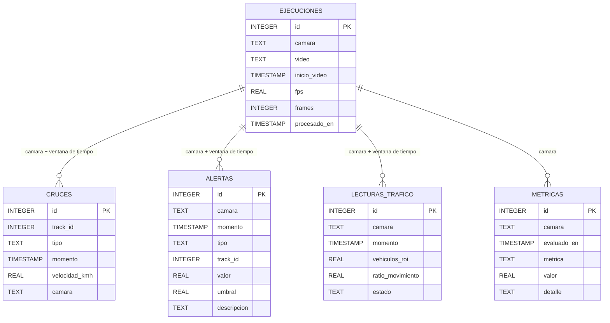

# Modelo de datos

Almacenamiento final: **SQLite 3** (`datos/db/database.db`, módulo estándar `sqlite3`), en modo
WAL para que el dashboard pueda leer mientras `main.py` escribe. No se usan CSV como
almacenamiento: los datos de entrada del sistema son video y todo lo que produce se
guarda en las tablas de abajo. Código: [`db.py`](../src/aforo/persistencia/db.py).

## Diagrama entidad-relación

Las tablas se relacionan **lógicamente** por `camara` (y por la ventana de tiempo de la
ejecución), no con claves foráneas: se insertan en streaming, mientras el video se
procesa, y una FK obligaría a ordenar inserciones y a bloquear escrituras sin aportar
integridad real (un cruce y una alerta pueden llegar en cualquier orden).



Además existe la **vista** `v_aforo_por_minuto` (conteos por minuto y tipo, derivada de `cruces`).

## Correspondencia con lo que pide el profesor

| Se pide guardar | Dónde | Cómo se genera |
|---|---|---|
| **Detecciones** | `cruces` | Cada fila es un vehículo detectado por YOLO, seguido por ByteTrack y confirmado al cruzar la línea de conteo (`track_id` = ID del tracker). |
| **Conteos** | `v_aforo_por_minuto` (vista) y `cruces` | Se derivan con `GROUP BY`; así no se duplica información (normalización). |
| **Lecturas** | `lecturas_trafico` y `velocidad_kmh` de `cruces` | Cada 5 s (`INTERVALO_LECTURA_S`): vehículos en la ROI, % de movimiento y estado de la vía. |
| **Alertas** | `alertas` | `EXCESO_VELOCIDAD` y `TRAFICO_DETENIDO` (reglas en [`alertas.py`](../src/aforo/analitica/alertas.py)). |
| Trazabilidad / calidad | `ejecuciones`, `metricas` | Qué video produjo cada dato y los resultados de `evaluar.py`. |

**Por qué no se guarda cada caja por frame:** en tráfico denso hay ~40 detecciones por frame
× 25 FPS ≈ 1 000 filas por segundo, casi todas del mismo vehículo repetido. El cliente
necesita eventos (un vehículo cruzó, a qué velocidad, hubo una alerta), no el flujo crudo.

## DDL

```sql
CREATE TABLE cruces (
    id             INTEGER PRIMARY KEY,
    track_id       INTEGER,
    tipo           TEXT,
    momento        TIMESTAMP,
    velocidad_kmh  REAL,
    camara         TEXT
);
CREATE INDEX idx_cruces_camara_momento ON cruces (camara, momento);

CREATE TABLE alertas (
    id           INTEGER PRIMARY KEY,
    camara       TEXT      NOT NULL,
    momento      TIMESTAMP NOT NULL,
    tipo         TEXT      NOT NULL,     -- EXCESO_VELOCIDAD | TRAFICO_DETENIDO
    track_id     INTEGER,                -- NULL si la alerta es de la vía
    valor        REAL,                   -- velocidad medida o vehículos detenidos
    umbral       REAL,                   -- límite superado
    descripcion  TEXT
);

CREATE TABLE lecturas_trafico (
    id                 INTEGER PRIMARY KEY,
    camara             TEXT      NOT NULL,
    momento            TIMESTAMP NOT NULL,
    vehiculos_roi      REAL,             -- promedio en el intervalo
    ratio_movimiento   REAL,             -- 0..1, promedio en el intervalo
    estado             TEXT              -- LIBRE | FLUIDO | DETENIDO
);

CREATE TABLE ejecuciones (
    id INTEGER PRIMARY KEY, camara TEXT NOT NULL, video TEXT NOT NULL,
    inicio_video TIMESTAMP NOT NULL, fps REAL, frames INTEGER, procesado_en TIMESTAMP NOT NULL
);

CREATE TABLE metricas (
    id INTEGER PRIMARY KEY, camara TEXT NOT NULL, evaluado_en TIMESTAMP NOT NULL,
    metrica TEXT NOT NULL, valor REAL, detalle TEXT
);

CREATE VIEW v_aforo_por_minuto AS
SELECT camara, strftime('%Y-%m-%d %H:%M', momento) AS minuto, tipo,
       COUNT(*) AS vehiculos, ROUND(AVG(velocidad_kmh), 1) AS velocidad_promedio_kmh
FROM cruces GROUP BY camara, minuto, tipo;
```

La fuente de verdad del esquema es `db.py` (`SENTENCIAS_ESQUEMA`); se ejecuta al abrir la
base y todas las sentencias son `IF NOT EXISTS`, de modo que reabrirla no borra datos.

## Diccionario de datos

**`cruces`** (la tabla principal, una fila por vehículo contado)

| Campo | Tipo | Descripción |
|---|---|---|
| `id` | INTEGER PK | Autonumérico de la fila. |
| `track_id` | INTEGER | ID que ByteTrack asignó al vehículo. Es único **dentro de una ejecución** (reinicia en 0 al procesar otro video). |
| `tipo` | TEXT | `Auto`, `Moto`, `Bus` o `Camion` (clase estabilizada por votación mayoritaria durante la vida del ID). |
| `momento` | TIMESTAMP | Instante del cruce de la línea de conteo = `FECHA_INICIO_VIDEO` + (frame ÷ FPS). Texto ISO `AAAA-MM-DD HH:MM:SS.mmm`. |
| `velocidad_kmh` | REAL | Velocidad media en la ROI (distancia real ÷ tiempo de tránsito). `NULL` si el vehículo no completó la ROI. |
| `camara` | TEXT | Fuente de video (`CAMARA` en `config.py` o `--camara`). |

**`alertas`**: `tipo` ∈ {`EXCESO_VELOCIDAD`, `TRAFICO_DETENIDO`}; `valor` es la velocidad (km/h) o el
número de vehículos detenidos; `umbral` es el límite que se superó (`LIMITE_VELOCIDAD_KMH` o
`DETENIDO_MIN_VEHICULOS`); `track_id` es `NULL` en las alertas de la vía.

**`lecturas_trafico`**: promedio de lo ocurrido en cada intervalo de `INTERVALO_LECTURA_S` s;
`estado` es el de la máquina de estados de [`alertas.py`](../src/aforo/analitica/alertas.py) al cerrar el intervalo.

**`ejecuciones`**: una fila por corrida de `main.py`; permite a `evaluar.py` convertir `momento` en
"segundos desde el inicio del video" para compararlo con la verdad de terreno.

**`metricas`**: una fila por métrica y evaluación (`eventos_precision`, `eventos_recall`, `eventos_f1`,
`aforo_error_pct`, `velocidad_mae_kmh`, ...).

## Consultas de ejemplo

```sql
-- Aforo por tipo
SELECT tipo, COUNT(*) AS vehiculos, ROUND(AVG(velocidad_kmh), 1) AS vel_prom
FROM cruces WHERE camara = 'autopista_1' GROUP BY tipo;

-- Vehículos por minuto (vista)
SELECT * FROM v_aforo_por_minuto WHERE camara = 'autopista_1' ORDER BY minuto;

-- Excesos de velocidad, del más rápido al más lento
SELECT momento, track_id, valor AS kmh, descripcion
FROM alertas WHERE tipo = 'EXCESO_VELOCIDAD' ORDER BY valor DESC;

-- Episodios de tráfico detenido
SELECT momento, descripcion FROM alertas WHERE tipo = 'TRAFICO_DETENIDO';
```

## Decisiones de diseño

- **Timestamps como texto ISO-8601:** SQLite no tiene tipo fecha; el texto ISO se ordena
  cronológicamente y funciona con `strftime`. Se convierte explícitamente (el adaptador
  automático de `sqlite3` está obsoleto desde Python 3.12).
- **`INSERT` inmediato con `commit()` por fila:** el dato queda durable en cuanto el vehículo
  cruza y el dashboard lo ve en vivo.
- **Consultas parametrizadas (`?`)** en todo el código: los valores nunca se concatenan al
  SQL, lo que previene inyección SQL (hay una prueba en `tests/test_db.py`).
- **Velocidad `NULL` en vez de 0** cuando no hubo medición: 0 km/h sería un dato falso.
- **Índices** `(camara, momento)` en las tablas que el dashboard filtra por cámara y hora.
